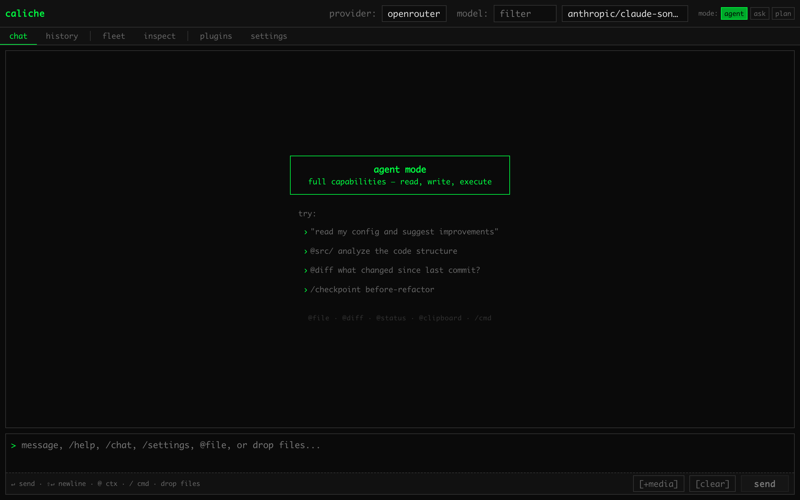

# Caliche

Caliche is a Rust runtime for creating an agent. An agent sends a prompt to a model provider that you choose, runs the tools that the model requests, and returns the result. You can use Caliche from the command line, over HTTP, from a web UI, or as a library in Rust, JavaScript, and Python.

## Why Caliche

- **One runtime behind every interface.** The CLI, the HTTP API, the web UI, and the Rust, JavaScript, and Python libraries all run the same agent code. The CLI, the HTTP API, and the web UI share the sessions of the process that they connect to.
- **Confined tools by default.** Shell and file tools run inside an operating system sandbox, and the default policy lets them write only inside the workspace. To run a tool without the sandbox, you pass `--sandbox danger-full-access`.
- **Your choice of model.** Hosted providers, local servers such as Ollama and LM Studio, and in-process local inference all go through the same provider interface.
- **Built from features.** Cargo features select the providers, tools, and storage backends that are compiled in, so you build only the parts that you choose. See [Feature flags](docs/reference/feature-flags.md).

## Features

- Calls a model provider of your choice. You supply the API key, or you use a local model. See [Providers](#providers).
- Runs tools on behalf of the model. The default tools are `fs`, `bash`, and `web_fetch`. See [Tools](docs/tools.md).
- Keeps a session, which holds the messages and tool results of one conversation.
- Serves sessions from the CLI, from an HTTP server started with `caliche --server`, and from a web UI on the same port as the server.
- Runs shell and file tools inside an operating system sandbox: Seatbelt on macOS, Landlock on Linux, and a Job Object on Windows.
- Checks every tool call against a policy before it runs. A policy can allow the call, ask you to approve it, or deny it.
- Supports the Model Context Protocol in both directions. Caliche can serve its tools as an MCP server and can use tools from other MCP servers. See [MCP](docs/integrations/mcp.md).
- Speaks the Agent Client Protocol over stdio, as the agent that an ACP client drives (`caliche --acp-stdio`) or as the client of another ACP agent. See [ACP](docs/integrations/acp.md).
- Coordinates more than one agent with an agent pool, handoff chains, workflow graphs, and reusable agent profiles. See [Orchestration](docs/architecture/orchestration.md).
- Receives messages from Telegram, Discord, Slack, Microsoft Teams, and Twilio through the gateway runtime, which verifies webhook signatures and can suspend and resume sessions durably. See [Gateway](docs/gateway.md).
- Attaches language server diagnostics to the results of file tools. See [Language servers](docs/integrations/lsp.md).
- Stores and searches embeddings with Dripstone when you configure retrieval.

The terms used throughout the documentation are defined in [Concepts](docs/concepts.md).

## Project status

- Caliche is at version `0.1.0`.
- No package is published: not to crates.io, npm, or PyPI, and there are no release binaries. Build every component from this repository.
- The minimum supported Rust version is 1.92. `rust-toolchain.toml` pins the toolchain to `1.92.0`.
- The CLI with the embedded web UI builds on macOS and Linux. On Windows, the supported build is the CLI without the web UI. See [Install](docs/install.md).

## Installation

Clone the repository with its submodule and install the CLI:

```bash
git clone --recurse-submodules https://github.com/nicholas-papachriston/caliche.git
cd caliche
./caliche rust install
```

`./caliche rust install` builds the web UI and installs the `caliche` binary with that UI embedded. The web UI build needs three tools in addition to Rust:

- `dx`, from dioxus-cli, at the same version as the `dioxus` crate in `caliche_web`.
- The `wasm32-unknown-unknown` target. The command adds it when `rustup` is on `PATH`.
- `wasm-opt` from binaryen, version 117 or later.

To install only the CLI, without the web UI and without those three tools, run:

```bash
cargo install --path caliche_cli --locked --force
```

A CLI installed this way serves the HTTP API, but `GET /` returns `404`. The full prerequisites, the Windows instructions, and the steps to confirm which build is on your `PATH` are in [Install](docs/install.md).

`shotput` is the only Git submodule. If you cloned without `--recurse-submodules`, initialize it with:

```bash
git submodule update --init shotput
```

## Quick start

First, give Caliche a provider and a key. The interactive setup asks for both:

```bash
caliche config setup
```

You can also store one key, or tell Caliche to read the key from an environment variable:

```bash
caliche config set openai --key sk-...
caliche config set anthropic --env ANTHROPIC_API_KEY
```

To choose a provider and a model for one run, pass `--provider` and `--model`. `caliche doctor` prints the provider that the CLI will use, and whether that choice came from a flag, your saved settings, the environment, or the built-in default. The CLI reads a `.env` file only when you pass `--env-file <path>`.

Start an interactive session (a REPL):

```bash
caliche
```

Send a single prompt, print the reply, and exit:

```bash
caliche --provider anthropic --message "Reply with the single word pong."
```

Add `--output-format json` for output that a script can parse.

Start the HTTP server on the loopback interface:

```bash
caliche --server --bind 127.0.0.1 --port 3000
```

A binary built with the web UI serves it at `http://127.0.0.1:3000/`. This is the UI before the first message, with no provider key set:



The HTTP API does not require authentication until you enable JWT. Read [Security](#security) before you expose the server to other hosts. To create a session and run a turn over HTTP, follow [HTTP sessions](docs/sessions/sessions.md).

To run the CLI from a checkout without installing it, use Cargo:

```bash
cargo run -p caliche_cli -- --help
cargo run -p caliche_cli -- --server --bind 127.0.0.1 --port 3000
```

## Providers

Pass one of these names to `--provider`, or set it in `DEFAULT_PROVIDER`:

| Provider | Name | Credentials |
| --- | --- | --- |
| OpenAI | `openai` | `OPENAI_API_KEY` |
| Anthropic | `anthropic` | `ANTHROPIC_API_KEY` |
| OpenRouter | `openrouter` | `OPENROUTER_API_KEY` |
| Google | `google` | `GOOGLE_API_KEY` |
| Cohere | `cohere` | `COHERE_API_KEY` |
| Perplexity | `perplexity` | `PERPLEXITY_API_KEY` |
| Cloudflare AI Gateway | `cloudflare-ai-gateway` | `CLOUDFLARE_AIG_API_KEY`, `CLOUDFLARE_ACCOUNT_ID` |
| Ollama | `ollama` | None. `OLLAMA_BASE_URL` sets the address. |
| LM Studio | `lmstudio` | None. `LMSTUDIO_BASE_URL` sets the address. |
| AWS Bedrock | `bedrock` | The AWS credential chain, for example `AWS_ACCESS_KEY_ID` and `AWS_REGION` |
| Azure OpenAI | `azure-openai` | `AZURE_OPENAI_API_KEY`, `AZURE_OPENAI_RESOURCE_NAME`, `AZURE_OPENAI_DEPLOYMENT_ID` |
| In-process local inference | `local-inference` | None. The model runs inside the Caliche process. |

The default CLI build includes every provider except AWS Bedrock, Azure OpenAI, and in-process local inference. Those three need a Cargo feature: `server-app` for Bedrock and Azure OpenAI, and `local-inference` for in-process inference. When nothing selects a provider, `caliche --server` and the standalone `caliche_server` binary use `openrouter`. The other variables for each provider are in [Environment variables](docs/reference/environment-variables.md).

## Architecture

| Path | Contents |
| --- | --- |
| `src/` | The `caliche` crate: the agent, providers, tools, sessions, and the gateway runtime. |
| `caliche_cli` | The `caliche` binary: the REPL, one-shot prompts, and the commands that start the server. |
| `caliche_server` | The HTTP API, the WebSocket handlers, and the embedded web UI. |
| `caliche_web` | The Dioxus web UI, compiled to WebAssembly. |
| `caliche_sandbox` | The sandbox backends for the shell and file tools. |
| `crates/caliche_policy` | The policy that allows, asks about, or denies each tool call. |
| `crates/caliche_orchestration` | Permissions and dispatch for more than one agent. |
| `crates/caliche_mcp` | The MCP types and server helpers. |
| `crates/caliche_acp_client` | The ACP client that drives another agent over stdio. |
| `crates/caliche_contracts` | The wire types shared by clients and servers. |
| `caliche_js`, `caliche_py` | The JavaScript (NAPI-RS) and Python (PyO3) bindings and their packages. |
| `dripstone` | Vector storage, search, and retrieval. |
| `shotput` | The prompt template engine, as a Git submodule. |

How a prompt moves through these parts is described in [Runtime lifecycle](docs/architecture/runtime-lifecycle.md).

## Using Caliche as a Rust library

Most programs need only `Agent`, which you build with `AgentBuilder`. Each type in the table below wraps the type above it and adds to it.

| Type | What it adds |
| --- | --- |
| `Agent` | Runs a model with tools. |
| `AgentService` | Settings, a tool registry, and session storage. The CLI and the HTTP server use this type. |
| `AgentHarness` | An event stream, checkpoints, and undo for one interactive session. |
| `AgentRuntime` | Many harness sessions in one process. |

To serve agents over HTTP from your own program, use the `caliche_server` crate, or run `caliche --server`.

```rust
use caliche::{AgentBuilder, ProviderType};

#[tokio::main]
async fn main() -> anyhow::Result<()> {
    let mut agent = AgentBuilder::new()
        .provider(ProviderType::OpenAI)
        .model("gpt-4o")
        .system_prompt("You are a helpful assistant.")
        .build()
        .await?;

    let reply = agent.chat("Hello").await?;
    println!("{reply}");
    Ok(())
}
```

Set `OPENAI_API_KEY` in the environment before you call `chat`. Add Caliche to a Rust project as a path dependency on this checkout, as shown in the [Rust SDK](docs/sdk/rust.md) guide.

## Using Caliche from JavaScript and Python

The bindings call the same Rust runtime. They are built from this checkout: run `bun install` and `bun run develop` in `caliche_js`, or `./caliche py build-dev` from the repository root.

```typescript
import { AgentBuilder } from "@caliche/core";

const agent = await new AgentBuilder()
  .provider("openai")
  .model("gpt-4o")
  .enableTool("calculator")
  .build();

const response = await agent.chat("What is 2 + 2?");
console.log(response.response);
```

```python
from caliche import AgentBuilder, ProviderType

agent = (
    AgentBuilder()
    .provider(ProviderType.OpenAI)
    .model("gpt-4o")
    .enable_tool("calculator")
    .build()
)

response, usage, _metrics = agent.chat("What is 2 + 2?")
print(response)
```

Streaming, hooks, and the other packages are in the [JavaScript SDK](docs/sdk/javascript.md) and [Python SDK](docs/sdk/python.md) guides, and in the [JavaScript](caliche_js/README.md) and [Python](caliche_py/README.md) package READMEs.

## Documentation

Getting started:

- [Concepts](docs/concepts.md)
- [Install](docs/install.md)
- [HTTP sessions](docs/sessions/sessions.md)
- [Examples](docs/examples.md)

Configuration and reference:

- [Configuration](docs/configuration.md)
- [Environment variables](docs/reference/environment-variables.md)
- [Tools](docs/tools.md)
- [Feature flags](docs/reference/feature-flags.md)
- [Binary formats](docs/reference/binary-formats.md)
- [Benchmarks](BENCHMARKS.md)

Libraries:

- [Rust SDK](docs/sdk/rust.md)
- [JavaScript SDK](docs/sdk/javascript.md)
- [Python SDK](docs/sdk/python.md)

Integrations:

- [MCP](docs/integrations/mcp.md)
- [ACP](docs/integrations/acp.md)
- [Language servers](docs/integrations/lsp.md)
- [Gateway](docs/gateway.md)

Architecture:

- [Runtime lifecycle](docs/architecture/runtime-lifecycle.md)
- [Orchestration](docs/architecture/orchestration.md)

Operations:

- [Logging and observability](docs/operations/logging-observability.md)
- [Production authentication checklist](docs/ops/production-auth-checklist.md)
- [Container image](docs/ops/container.md)

Components:

- [CLI](caliche_cli/README.md)
- [HTTP API](caliche_server/README.md)
- [Web UI](caliche_web/README.md)
- [Sandbox](caliche_sandbox/README.md)
- [Dripstone](dripstone/README.md)
- [Repository guide for coding agents](AGENTS.md)

## Contributing

Contributions are welcome. Read [CONTRIBUTING.md](CONTRIBUTING.md) for setup, conventions, and the checks to run before you push. The same checks are listed in [AGENTS.md](AGENTS.md).

## Security

These are the defaults:

- The CLI runs shell and file tools in the `workspace-write` sandbox. Tools can write only inside the workspace and a private temporary directory. `--sandbox` selects a stricter policy (`read-only`), or turns the sandbox off (`danger-full-access`, which logs a warning).
- Every tool call goes through the policy gate before any hook runs. A deny from the compiled-in floor always blocks the call, and a write outside the workspace needs approval.
- The file write tools refuse paths inside Git metadata, such as `.git` directories, in every approval mode.
- By default, the HTTP server listens on `127.0.0.1:3000` and does not authenticate requests, and all of its callers share one session list; see [HTTP server defaults](SECURITY.md#http-server-defaults).

`--yolo` approves every tool call that would otherwise ask for approval. It does not override a deny. Use it only in a disposable environment; the reason is in [SECURITY.md](SECURITY.md#accept-all).

To report a vulnerability, email `nicholas@papachriston.com`. The reporting process is in [SECURITY.md](SECURITY.md), and the settings for a public host are in the [production authentication checklist](docs/ops/production-auth-checklist.md).

## License

Caliche is licensed under either of the following, at your option:

- Apache License, Version 2.0 ([LICENSE-APACHE](LICENSE-APACHE))
- MIT license ([LICENSE-MIT](LICENSE-MIT))

Copyright (c) 2026 Nicholas Papachriston.
