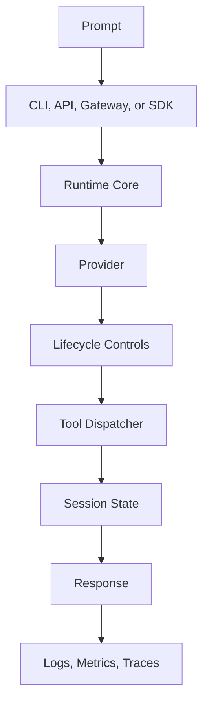

# Runtime lifecycle

This page describes how a request moves through the Caliche runtime, the controls that apply to tool calls, the optional operation dispatch path, and how failures are reported.

## From request to response

1. A prompt arrives through the CLI, the HTTP API, gateway ingress, or an SDK binding.
2. A host that uses `AgentRuntime` submits the prompt to the session inbox, which gives each input a stable id so that delivering the same input again has no effect. Callers that use `AgentService::chat` or `AgentHarness::run_turn` directly do not go through the inbox.
3. The input is converted into the runtime's message state.
4. The provider and model are resolved from the builder, CLI flags, environment variables, or stored defaults.
5. The lifecycle controls evaluate the tool calls that the model proposes.
6. The approved tools run, and their results are appended to the session state. By default, tools run through `ToolExecutionEngine`. When operation dispatch is enabled, see [Operation dispatch](#operation-dispatch).
7. When the context window fills up, compaction can produce a machine-readable `CompactionReport` together with the summary.
8. The assistant response is assembled and returned to the caller.
9. Logs, traces, token usage, and cost estimates are emitted where they are configured.

The default `on_turn_*`, `on_agent_*`, and `on_compaction` hooks run through `process_stream` and `dispatch_event`, and the REPL implements them. Slash command parsing is shared through `caliche_contracts::slash_intent` (`SlashIntent` and `parse_slash_intent`) for `/plan`, `/ask`, `/agent`, `/mode`, `/show-plan`, `/resume`, and `/attach`. The CLI also provides `/suspend`.



## Lifecycle controls

The runtime provides these controls:

- Lifecycle hooks that run before and after a tool call.
- Permission modes for tool calls.
- Filters that limit which tools are allowed.
- In-process MCP servers.
- Registration of external MCP servers as clients.
- Session snapshots and session forking.
- Durable suspend and resume (`AgentRuntime::suspend` and `resume_with`), which survive a process restart and include the session inbox and compaction reports.
- An idempotent session inbox (`AgentRuntime::submit_input`) for external, control, and crash recovery inputs. The inbox belongs to one harness; it does not cover every prompt in the process.
- An optional operation manager (`AgentBuilder::enable_operation_dispatch` or `with_operation_manager`) that turns tool calls into versioned, serializable operations. See [Operation dispatch](#operation-dispatch).
- Gateway egress allowlists for tool, MCP, and provider HTTP requests.
- Declarative workspace warm-start of repositories, MCP servers, and skills through `workspace_declaration::WorkspaceDeclaration`.

Use these controls when the agent should be limited to a subset of tools, when tool inputs need policy checks, or when tool calls need to be observable.

## Operation dispatch

Operation dispatch is off by default, and tool calls go through `ToolExecutionEngine`. When you enable it, each tool call is translated into a versioned operation, committed, and then executed:

- The local manager translates the call, commits the operation, executes it with `ToolExecutionEngine`, and records the results with `record_engine_results`. Isolation and parallel batching are the same as on the default path, and enabling it does not turn off OS sandboxing.
- The remote manager translates the call, commits the operation, and calls `OperationManager::execute` on each operation through `join_all`. Batches run with the same concurrency as on the default path, and the results are sorted back into call order. When a sandbox is configured, the remote manager refuses to run unless its transport is a `SandboxOperationTransport` bound to the agent's sandbox handle.

| Concept | Caliche type |
| --- | --- |
| Tool translator (synchronous, no I/O) | `agent::operations::ToolTranslator` (`BashToolTranslator`, `FsToolTranslator`, `RegistryToolTranslator`) |
| Operation | `agent::operations::Operation` (a versioned JSON specification) |
| Operation manager | `agent::operations::OperationManager` |
| Local manager | `LocalOperationManager`. The commit is recorded for audit only, and `ToolExecutionEngine` executes. This is the default manager when dispatch is enabled. |
| Remote manager | `RemoteOperationManager` with a `RemoteOperationTransport` or a `SandboxOperationTransport`. A configured sandbox requires the latter. |
| Session inbox | `harness::inbox::SessionInbox` on `AgentRuntime`. `AgentService` and a standalone harness do not have one. |
| Input id | `InboxInput.id`, supplied by the caller or generated and returned. |
| Control modes | `ControlMode::{Hard, WhenIdle, Heartbeat, Settings}` |
| Context builder report | `messages::CompactionReport` (`kind`, `source`, and `reason`), saved on `SuspendedSession` |

### Enabling operation dispatch

```rust
let service = AgentBuilder::new()
    .enable_operation_dispatch() // or set CALICHE_OPERATION_DISPATCH=1
    .build()
    .await?;
```

To run operations in a remote or sandboxed worker while the coordinator keeps the provider credentials:

```rust
let transport = Arc::new(SandboxOperationTransport::new(sandbox_handle));
let manager = Arc::new(RemoteOperationManager::new(transport));
let service = AgentBuilder::new()
    .with_operation_manager(manager)
    .build()
    .await?;
```

### Session inbox

```rust
let outcome = runtime
    .submit_input(&session_id, InboxInput::external(Some("evt-1"), "hello"))
    .await?;
// Delivering evt-1 again after a resume does not run a second turn.
```

Control messages share the same id space as other inputs. The control messages are a hard stop, a stop when idle, a heartbeat, and a settings change.

## Failures

- When a hook or the policy denies a tool call, the tool result reports the denial with the configured reason.
- Tool errors and provider errors are recorded in the runtime state, where they can be retried or reported to the caller.
- If gateway routes do not match, restart the registered gateway runtime.
- Session snapshots are read only in the current rkyv version 1 format.

## Related code

- `src/agent/`
- `src/agent/hooks/`
- `src/agent/session/`
- `src/llm/`
- `src/mcp/`
- `src/observability/`
